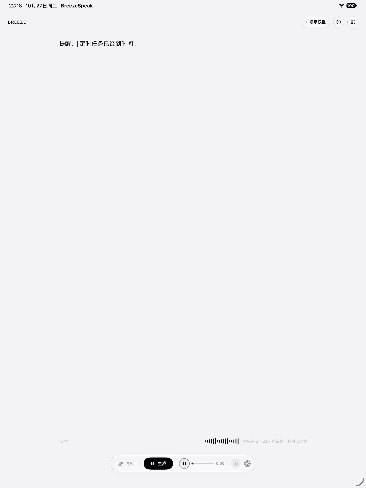
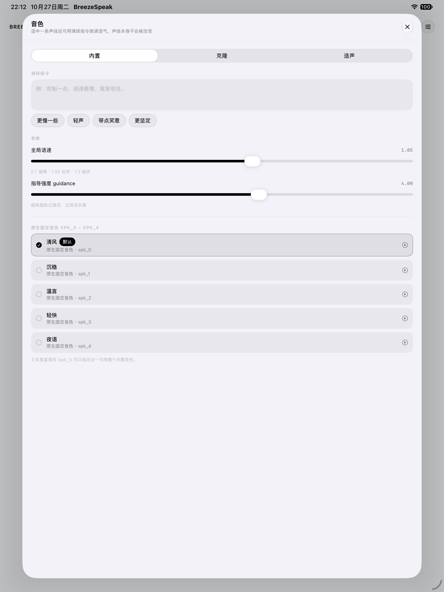
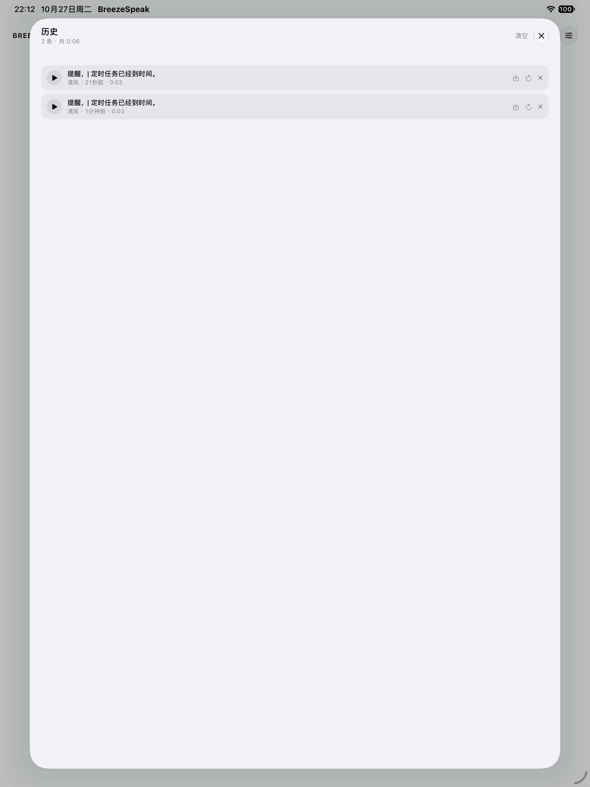
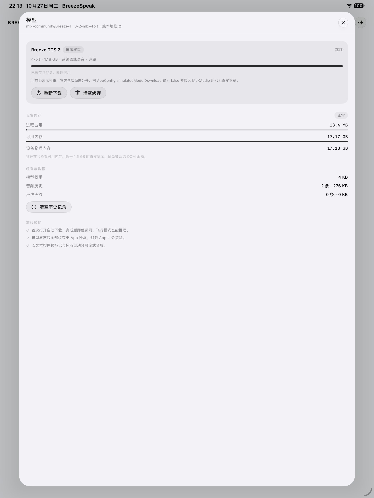
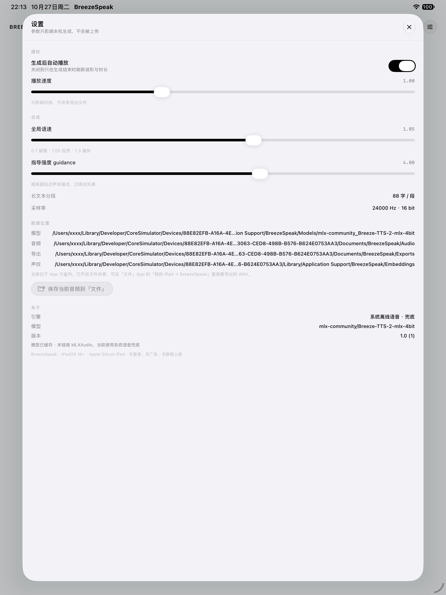
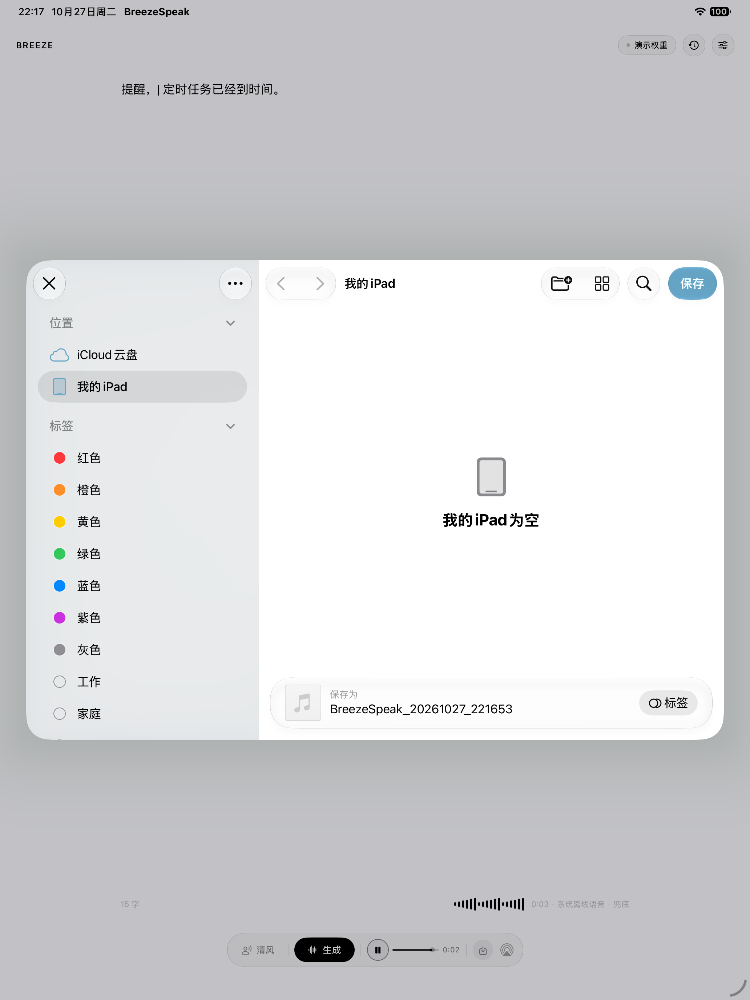
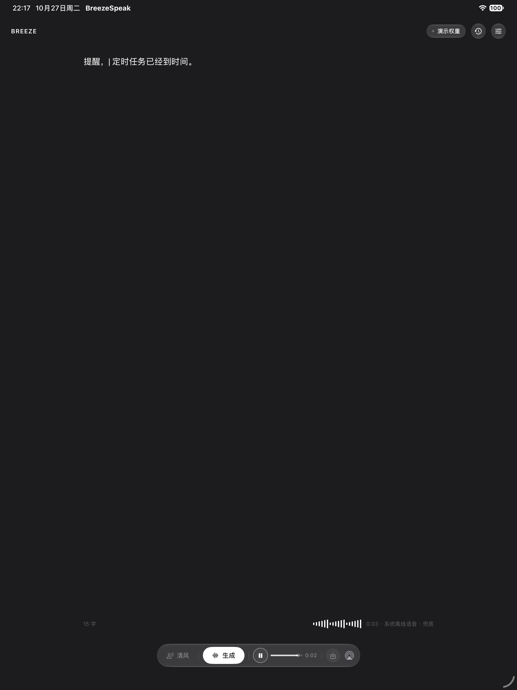

# BreezeSpeak

独立 iPad SwiftUI 离线 TTS 应用。原生离线、无登录、无广告、无联网上报，模型与声纹全部落在 App 沙盒内。

- 最低系统：iPadOS 16.0
- 设备限定：仅 iPad（`UIDeviceFamily = 2`），Apple Silicon M 系列
- 界面：**与 macOS 版 BreezeTTS 完全一致**——一块书写面 + 一条悬浮玻璃工具栏，
  音色 / 历史 / 模型 / 设置全部收进弹窗；单色设计语言，深浅色随系统翻转



---

## 一、如何打开与编译

1. 打开 `BreezeSpeak.xcodeproj`，Scheme 选 `BreezeSpeak`。
2. 在 *Signing & Capabilities* 里选自己的 Apple ID Team（免费账号即可）。
   - 工程里已预置 `DEVELOPMENT_TEAM = 6S7H7VW64C`，换成你自己的 Team ID 即可；免费账号直接沿用也行。
   - Bundle Identifier 默认 `com.breezespeak.app`，若提示已被占用，改成你自己的唯一 ID，例如 `com.yourname.breezespeak`。

### 装到真机 iPad（免费账号）

前置条件**必须**满足两条，缺一不可：

1. **iPad 用数据线连 Mac**，iPad 上弹窗点「信任此电脑」。
2. **Xcode 已登录 Apple ID**：`Xcode → Settings → Accounts → +` 用 Apple ID 登录（这一步只能在 Xcode 图形界面做，命令行无法代替，2FA 需要你本人确认）。

然后二选一：

- **图形界面**：Xcode 顶部设备选择器选中你的 iPad → 按 `⌘R`。首次会弹「注册设备」，同意即可。
- **命令行**：`./Tools/run-on-ipad.sh`（会把设备 UDID 传给 `-destination`，自动注册设备、生成描述文件、安装并启动）。

首次安装若提示「不受信任的开发者」，去 iPad `设置 → 通用 → VPN与设备管理` 点信任；
若 Xcode 提示需要开启开发者模式，去 iPad `设置 → 隐私与安全性 → 开发者模式` 打开并重启。

> **免费账号有 3 个 App 的硬上限**（每台设备）。装第 4 个时报
> `IXUserPresentableErrorDomain error 14`「This device has reached the maximum number of installed apps using a free developer profile」，
> 必须先卸载一个自签 App 才能继续。

免费证书 7 天过期，到期重跑一次即可；App 沙盒数据（模型、声纹、历史）不会丢。

已在本机验证：arm64 真机编译 **0 error 0 warning**；签名环节因本机 Xcode 未登录任何 Apple ID 而无法由命令行自动完成（`error: No Accounts`）。

命令行编译（本机已验证通过）：

```bash
xcodebuild -project BreezeSpeak.xcodeproj -scheme BreezeSpeak \
  -sdk iphonesimulator -destination 'platform=iOS Simulator,name=iPad Pro 13-inch (M5)' \
  -configuration Debug build
```

> 如果宿主机 shell 处于受限沙箱中，编译器调用宏插件会报
> `swift-plugin-server produced malformed response` / `sandbox-exec: sandbox_apply: Operation not permitted`。
> 这是宿主环境限制，不是工程问题，追加下面参数即可：
> `OTHER_SWIFT_FLAGS='$(inherited) -Xfrontend -disable-sandbox'`

---

## 二、推理引擎：与 macOS 版同源

iPad 上跑的不是系统语音，也不是 MLX 移植，而是**和 macOS 版完全同一套 C++ 推理核心**：

```
Breeze-TTS-2.Cpp/  (ggml + breeze_core，上游同一份源码)
        │  交叉编译为 iOS arm64
        ▼
Vendor/BreezeEngine.xcframework   ← libbreeze.a（iphoneos + iphonesimulator 双切片）
        │  ObjC 薄桥接
        ▼
BreezeSpeak/Bridge/BreezeBridge.{h,mm}   ← 只负责填 breeze_request、拷贝 chunk
        │
        ▼
BreezeSpeak/Audio/BreezeLocalEngine.swift ← TTSEngine 适配：GGUF 加载、流式回吐、取消
```

- **权重同源**：`HoppouAI/Breeze-TTS-2.cpp` 的 GGUF（Q4_K / Q6_K / Q8_0），与 Mac 版逐字节一致。
- **后端同源**：ggml 的 Metal 后端，权重走 mmap，GPU 直接读。
- **参数同源**：`cfg_scale` 取界面上的指导强度、`seed` 固定 4242、`split_chars` 600（约 40 秒音频一段）；
  采样用 `top_k 1` + `repetition_penalty 1.15` —— 贪心保证同一段文字逐样本可复现，
  重复惩罚专压句尾越拖越长的静音。
- **系统语音只是兜底**：只有权重没下载完时才回落到 `AVSpeechSynthesizer`，界面会明确标注。

### 重新编译引擎（只在需要改 C++ 侧时做）

```bash
./Tools/build-engine-ios.sh          # 设备 + 模拟器，产出 Vendor/BreezeEngine.xcframework
```

前提：`Breeze-TTS-2.Cpp` 源码放在 `BREEZE_SRC` 指向的路径（默认取同级的 macOS 工程），
以及 `cmake` / `ninja`（脚本里已指向托管 Python 环境里的那份）。

脚本做了两件上游没做的事：

1. 用 iOS toolchain（`CMAKE_SYSTEM_NAME=iOS`、`iphoneos`/`iphonesimulator` sysroot、`arm64`、
   `deployment target 16.0`）交叉编译 `breeze_core` + ggml，`-DGGML_CPU_ARM_ARCH=armv8.6-a+dotprod+i8mm+fp16`
   打开 NEON / dot-product，避免 CPU 路径退回标量。
2. 上游只把 `src/c_api.cpp` 编进 shared lib，静态库链不到 `breeze_init` 等符号，
   所以脚本单独编一份 `c_api.o` 再 `libtool` 合进归档，最后打包成 xcframework。

> 模拟器里 Metal 用 XPC 共享内存搬权重，GB 级缓冲会直接 trap（`xpc_api_misuse`），
> 所以 `BreezeLocalEngine` 在模拟器固定走 CPU；真机一路 Metal。

### 音色是怎么来的

引擎原生只有一个基础音色（prompt 里的 `[S0]`），没有 `spk_0…spk_4` 这一说。
所以「我的声线库」的三类音色是这样落地的，和 Mac 版完全一致：

| 类型 | 落地方式 | 引擎参数 |
| --- | --- | --- |
| 内置五条声线 | 固定的英文声音描述（voice design） | `instruction` |
| 文字造声 | 用户写的描述原文 | `instruction` |
| 声音克隆 | 参考音频 + 参考文稿 | `ref_audio` + `ref_text` |
| 演绎指令 | 直接拼进 instruction | `instruction` |
| 语速 | 转成 pace 描述，`(slow)` `(fast)` 再叠一层 | `instruction` |

`|` / `||` 在这个引擎里没有专门的停顿 token，所以映射成 `，` / `。`（听感等效且稳定）；
`(whisper)` 转成 `(whispering)` 交给模型；`[笑]` `[叹气]` 原样保留。
副语言标记要真正生效需要把 `cfg_scale` 抬到 2~3，默认 1.0 时模型把它当建议。

---

## 三、首次启动

第一次打开走四步，全部完成后记在 `UserDefaults`，之后不再出现：

1. **介绍** —— 应用做什么、数据去了哪里。
2. **使用须知** —— 五条免责条款，勾选同意才能继续；条款版本单独记录（`Core/OnboardingState.swift`），
   将来修条款只会重过这一页。
3. **选择模型** —— Q4_K / Q6_K / Q8_0 三档，标出本机推荐与已下载状态，支持断点续传、暂停，也可以先跳过。
4. **开始使用** —— 三条操作提示，点「进入 BreezeSpeak」即进入主界面。

中途退出会接着走：已经同意过协议的用户，下次直接从选模型开始。首次启动不会在用户读完协议前就去下载权重，
`AppEnvironment` 只在引导完成（或老用户升级）时才自动补齐模型。

## 四、功能对照

### 书写面
- 一整块编辑区（17pt、行距 7、列宽上限 700pt 居中），写完直接点「生成」。
- **文本生成后保留在原处**，方便改几个字再合成一次，不会像对话式那样把输入清空。
- 原生标记全部解析：`|` 短停顿、`||` 长停顿、`(slow)` `(fast)` `(whisper)`、`[笑][叹气][咳嗽]`。
- 副语言标记由模型原生渲染（`cfg_scale` 抬到 2~3 时最明显）。
- 页脚实时显示字数、电平表（合成/播放时）、以及引擎与时长。
- **生成耗时预估**：页脚随时显示「⏱ 约 X 秒」，生成中状态行变成「合成中 N% · 剩约 X 秒」。
  预估基于引擎实测的实时率（生成 1 秒音频要算几秒，按权重档位分别记录、指数平滑），
  权重还没加载时再加上一次实测的冷启动加载时间；越用越准。见 `Core/GenerationEstimator.swift`。

### 悬浮工具栏
`声线 · 生成/停止 · 播放 · 进度条 · 时间 · 导出 · AirPlay`，一整条液态玻璃胶囊，
内容随状态增减（没音频时不显示播放组）。

### 我的声线库（音色面板，3 个 Tab）
| Tab | 能力 |
|---|---|
| 内置 | `spk_0`~`spk_4`，试听 / 选用 / 设为默认 / 重命名（长按出菜单） |
| 克隆 | 导入 wav/m4a → 填原话文稿 → 一键提取声纹 → 试听 → 命名保存；上限 12 条 |
| 造声 | 声音描述大输入框 + `guidance_scale` 1~6 → 生成独立声线 → 试听 → 保存 |

克隆校验在提取前判定并弹窗：音频过短/过长、噪音过高（SNR）、文稿与音频不匹配（按字数与时长估算语速区间）、近乎静音。
声纹 embedding 持久化到 `Application Support/BreezeSpeak/Embeddings`，不会每次重算。

### 演绎调节
同一面板内：演绎指令输入框 + 4 个语气预设 + 全局语速 0.7~1.3（默认 1.05）+ 指导强度 1~6（默认 4）。
演绎只改语气节奏，不动声线本身。

### 音频与导出
- 播放/暂停、可拖动的进度条、当前时间、实时电平表，AirPlay 走系统原生 `AVRoutePickerView`。
- **保存到「文件」**：工具栏导出键 → 系统存储面板（已验证可保存到「我的 iPad」）；
  历史里每条也能单独导出。
- 另一条路径：设置面板「保存当前音频到『文件』」直接写 `文件/BreezeSpeak/Exports`，
  已在模拟器实测落盘（138 KB WAV）。
- 长文本按 `|`、`||`、标点与 88 字上限自动分段流式合成。
- 推理结束释放中间缓冲；进入后台立刻 `unloadAll()` 并停止采样。

### 历史
每条保存文本、声线、演绎、指导强度、语速、WAV 文件；支持重听、导出、原参数重生成、删除、一键清空。

### 快捷指令
`GenerateSpeechIntent`（App Intents，已生成 `Metadata.appintents`）：
参数为文本、声线 ID（UUID / `spk_0`~`spk_4` / 声线名）、演绎指令，返回 WAV，可串接「存储到文件 / 播放」。

---

## 五、界面

与 macOS 版 BreezeTTS 同一套信息架构：**一块书写面 + 一条悬浮玻璃工具栏**，功能全部收进弹窗。

| 主界面 | 音色（三 Tab） | 历史 |
|---|---|---|
|  |  |  |

| 模型 | 设置 | 保存到「文件」 |
|---|---|---|
|  |  |  |

深色模式：



实现要点：

- **配色**：单色体系。`Theme.canvas` 取 iOS `secondarySystemBackground`（浅 #F2F2F7 / 深 #1C1C1E），
  对齐 macOS `windowBackgroundColor`；其余全部用 `Color.primary` 的各档透明度，不硬编码颜色。
- **玻璃**：iOS 26+ 用系统 `glassEffect`（工具栏胶囊 + 顶栏图标），低版本退回 `.regularMaterial`
  加极细描边与克制投影；一套 `glassCard` / `glassCapsule` 复用到底。
  **设置 → 外观 → 液态玻璃** 可随时关掉，退回毛玻璃；开关状态落 UserDefaults，所有玻璃面即时跟随。
- **弹窗**：统一 `SheetChrome`（标题 + 副标题 + 关闭键 + 细分隔线 + 可滚动内容），
  iOS 18 上用 `presentationSizing(.page)`、16.4 起用 `presentationBackground`，
  低版本由 `Core/Compat.swift` 自动跳过，内容再长也不会被裁掉。
- **状态提示**：不再用浮层 toast，直接占用页脚状态行，避免压住控件。

---

## 六、目录结构

```
BreezeSpeak/
├── BreezeSpeak.xcodeproj/          手写工程（objectVersion 77，文件系统同步分组）
├── BreezeSpeak/
│   ├── BreezeSpeakApp.swift        入口、ScenePhase 内存策略
│   ├── Core/
│   │   ├── AppConfig.swift         模型信息、沙盒路径、可调参数
│   │   ├── Theme.swift             单色配色（对齐 macOS 窗口色）
│   │   ├── DesignSystem.swift      玻璃卡片/胶囊、主次按钮、分组标题、键值行、电平表、弹窗外壳
│   │   └── DebugHarness.swift      仅 DEBUG 的自动化走查（截图用，发布构建不含）
│   ├── Models/                     VoiceProfile、HistoryRecord、PromptTemplate
│   ├── Services/                   VoiceStore / HistoryStore / ModelManager / MemoryMonitor / SpeechRuntime / DiskStore
│   ├── Audio/                      TTSEngine 协议、MLXAudioEngine、SystemSpeechEngine、WAVFile、TextSegmenter、VoiceSignatureFactory、AudioPlayback
│   ├── ViewModels/                 AppEnvironment、SynthesisViewModel、VoiceLabModel
│   ├── UI/
│   │   ├── MainSurface.swift       书写面 + 悬浮玻璃工具栏
│   │   ├── VoiceSheet.swift        音色：内置 / 克隆 / 造声 + 演绎 + 参数
│   │   ├── HistorySheet.swift      历史（重听 / 导出 / 复用 / 删除）
│   │   ├── ModelSheet.swift        模型、内存、缓存、离线说明
│   │   └── SettingsSheet.swift     播放、合成参数、数据位置、关于
│   └── Intents/                    GenerateSpeechIntent + AppShortcutsProvider
└── Docs/screenshots/
```

约 5.3k 行 Swift，30 个文件，无第三方依赖。

---

## 七、已知边界

- 兜底引擎下 `[笑][叹气][咳嗽]` 只做停顿处理，无法真的笑出来——那是模型侧能力，接入真实 TTS 后自然生效。
- `guidance_scale` 在兜底模式仅影响描述解析权重，不改变声学；真实推理时会原样传给模型。
- 模拟器里 `os_proc_available_memory()` 恒返回 0，界面显示「约 xx GB」为「总量 − footprint」估算；真机是精确值。
