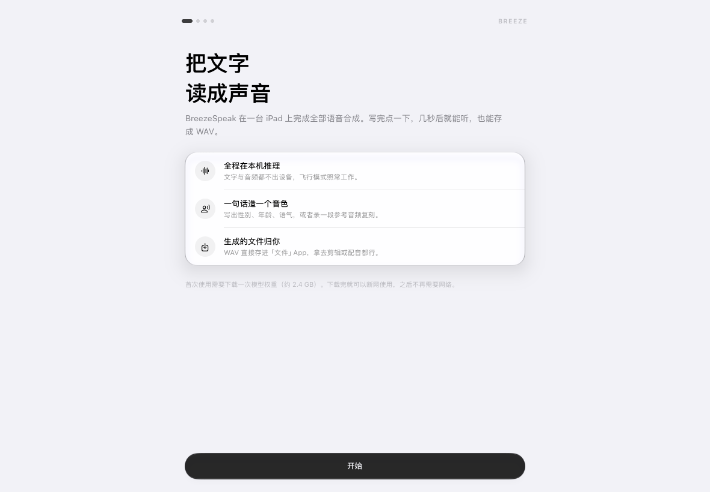
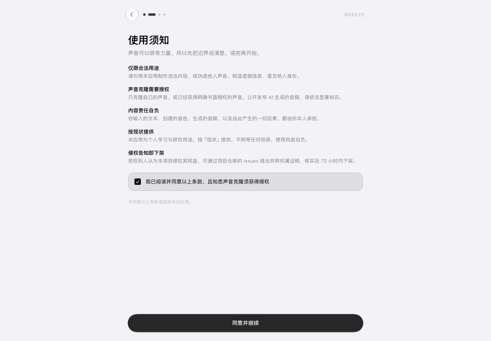
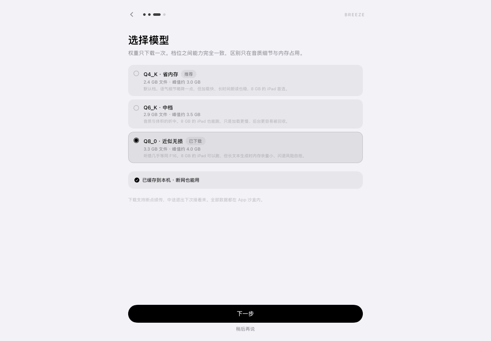
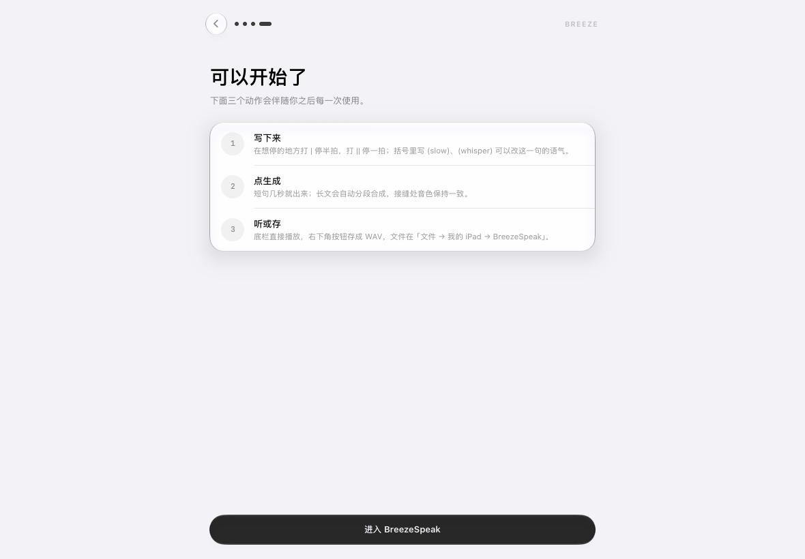

# Breeze TTS

本地离线语音合成。**macOS 版 BreezeTTS Lite** 与 **iPad 版 BreezeSpeak** 共用同一套 GGUF 权重、
同一份 C++ 推理核心（ggml + Metal）：没有 WebView、没有本地 HTTP 服务、没有账号，推理全部在设备内完成，
文本与音频都不上传。

- 引擎：[`HoppouAI/Breeze-TTS-2.cpp`](https://github.com/HoppouAI/Breeze-TTS-2.cpp)（Apache-2.0，Metal 后端）
- 界面：SwiftUI，单色设计语言；液态玻璃（新系统）与毛玻璃两套外观可切换
- 分发：macOS 走 DMG，iPad 走 IPA 或自行编译

> ⚠️ **仅供个人学习、研究与自用。** 请勿用于违法用途或侵害他人权益（尤其是未经授权克隆他人声音）。
> 本项目按「现状」提供、不附带担保，使用风险自负。详见 [DISCLAIMER.md](DISCLAIMER.md)。
> 如有侵权请通过 Issues 告知，核实后 72 小时内下架。


## 两个版本

| | macOS 版 | iPad 版 |
| --- | --- | --- |
| 名称 | BreezeTTS Lite | BreezeSpeak |
| 系统 | macOS 12 Monterey 及以上 | iPadOS 16 及以上 |
| 芯片 | Apple Silicon（M1 及以后） | Apple Silicon iPad |
| 形态 | 独立窗口，一块书写面 + 悬浮工具栏 | 全屏，同一套信息架构，触屏适配 |
| 分发 | DMG | IPA / 源码编译 |

## 下载

| 平台 | 文件 |
| --- | --- |
| macOS | [`downloads/BreezeTTS-Lite-1.0-arm64.dmg`](downloads/BreezeTTS-Lite-1.0-arm64.dmg) |
| iPad | [`downloads/BreezeSpeak-1.0-ipad-arm64.ipa`](downloads/BreezeSpeak-1.0-ipad-arm64.ipa) |

也可以在 [Releases](https://github.com/keshaogang/BreezeTTS-Lite/releases) 页下载同一份文件。

### macOS 安装

1. 打开 DMG，把 `BreezeTTS Lite.app` 拖进「应用程序」。
2. 首次打开若提示「无法验证开发者」→ 右键 App → 打开；若提示「已损坏」→ 终端执行
   `xattr -cr "/Applications/BreezeTTS Lite.app"`。（未做 Apple 公证，属正常现象）
3. 首次启动引导页选一个模型档位下载（Q8_0 约 3.6 GB；8 GB 内存建议 Q4_K），下完即可全程离线。

### iPad 安装

1. 用 Xcode 打开 `BreezeSpeak-iOS/BreezeSpeak.xcodeproj`，在 *Signing & Capabilities* 里选自己的 Team，
   改一个唯一的 Bundle Identifier。
2. 选中你的 iPad，按 `⌘R`。首次会提示注册设备，同意即可。
3. 装完若提示「不受信任的开发者」，去 iPad `设置 → 通用 → VPN与设备管理` 信任对应证书；
   若提示需要开发者模式，去 `设置 → 隐私与安全性 → 开发者模式` 打开并重启。

`downloads/` 里的 IPA 是开发签名版，装到签名描述文件中登记过的设备即可使用，重新签名后同样能装。

模型权重不随仓库分发，需在应用内下载。全部数据都落在各自的 App 沙盒 / 应用支持目录里，卸载应用即清除。

---

## 一、iPad 版 · 首次启动

第一次打开会走四步，之后不再出现：

| 介绍 | 使用须知 | 选择模型 | 开始使用 |
| --- | --- | --- | --- |
|  |  |  |  |

1. **介绍**：应用做什么、数据去了哪里，三句话说清。
2. **使用须知**：五条免责条款，必须勾选同意才能继续；不同意则退出应用。条款版本会记录，将来改条款时只重过这一页。
3. **选择模型**：Q4_K / Q6_K / Q8_0 三档，标出本机推荐项与已下载状态；支持断点续传、随时暂停，也可以先跳过稍后下载。
4. **开始使用**：三条操作提示（怎么写停顿、怎么点生成、文件存哪儿），点「进入 BreezeSpeak」即进入主界面。

中断在任意一步都没关系：下次打开会接着走，已经同意过的协议不会重复要求。

### 系统要求

| 项目 | 要求 |
| --- | --- |
| 设备 | Apple Silicon iPad（M1 / M2 / M3 / M4 / M5 及以后） |
| 系统 | iPadOS 16.0 及以上 |
| 内存 | 8 GB 可跑 Q4_K；16 GB 及以上推荐 Q8_0 |
| 磁盘 | 首次需下载 2.4–3.3 GB 模型，建议留 4 GB 以上 |

### 界面

主界面是一块书写面加一条悬浮工具栏：声线、历史、模型、设置全部收进弹窗，写作时不堆面板。
iOS 26 起工具栏与弹窗使用系统的液态玻璃材质；**设置 → 外观** 里有「液态玻璃」开关，
关掉即退回毛玻璃，深色背景下更实、更安静。低版本系统默认就是毛玻璃外观。

其余细节见 [`BreezeSpeak-iOS/README.md`](BreezeSpeak-iOS/README.md)：引擎接入、音色映射、分段策略、目录结构。

### 快捷指令

在「快捷指令」App 里搜 `BreezeSpeak`，共有 7 个动作，全部不用先打开 App：

| 动作 | 说明 |
| --- | --- |
| 生成播报音频 | 文本 + 声线 + 演绎指令 + 语速倍率，直接返回 WAV |
| 快速克隆声音 | 给一段参考音频和名字，建成一条克隆声线 |
| 文字造声 | 用一句描述造一条声线（如「清亮的女声，语速偏快」），可顺手设为默认 |
| 设置默认声线 | 直接改默认声线，不打开 App 也能生效 |
| 列出声线 | 返回全部声线（内置 / 克隆 / 造声），可接「从列表中选取」 |
| 获取当前声线 | 返回默认声线的名字与标识 |
| 打开界面 | 落到正文、音色库、克隆、造声、历史、设置中任意一页 |

「生成播报音频」的参数：

| 参数 | 说明 |
| --- | --- |
| 文本 | 要朗读的内容，`\|` `\|\|` `(slow)` `(whisper)` 等标记照常生效 |
| 声线 | 下拉选择，内置、克隆、造声的声线都在列表里；留空用默认声线 |
| 演绎指令 | 例如「温柔一点，语速稍慢」 |
| 语速倍率 | 0.5–2.0，默认 1.0 |

返回的是 WAV 文件，可以接着串「保存到文件」「播放」「隔空投送」「发送信息」。
也可以直接对 Siri 说「用 BreezeSpeak 生成播报」，不用先做任何配置。

### 控制中心

下拉控制中心 → 长按空白处 → 左下角 `+` → 搜 `BreezeSpeak`，有四个按钮：

| 按钮 | 落点 |
| --- | --- |
| 新建朗读 | 正文，光标已在输入区 |
| 克隆声音 | 音色库的「克隆」页 |
| 音色库 | 声线列表 |
| 文字造声 | 音色库的「造声」页 |

按钮走的是和小组件同一套深链，点下去直接落到对应页面，不会先在首页停一下。

### 桌面小组件

长按桌面空白处 → 左上角 `+` → 搜 `BreezeSpeak`，小 / 中 / 大三种尺寸：

| 尺寸 | 内容 |
| --- | --- |
| 小 | 波形标记 + 一个「开始朗读」 |
| 中 | 品牌 + 新建朗读 / 声线库 / 最近生成 三个入口 |
| 大 | 中号的全部内容 + 停顿标记速查 + 三步操作提示 |

### 锁屏小组件

长按锁屏 → 自定义 → 添加小组件 → `BreezeSpeak`，圆形 / 矩形 / 行内三种。
刻意显示为极简样式：锁屏是公共场合，不把正文内容摆在上面。

小组件上的每个入口都是深链，点「新建朗读」直接落进正文并把光标放进输入区，
点「声线库」「最近生成」直接打开对应弹窗，不会先生成一次再让你自己找。

### 从源码编译

```bash
cd BreezeSpeak-iOS

# 用自己的 Team 签一次即可：主 App、小组件扩展、快捷指令与
# 控制中心按钮会一起编进去（扩展有自己的 bundle id，需要同一 Team 下的描述文件）
xcodebuild -project BreezeSpeak.xcodeproj -scheme BreezeSpeak \
  -configuration Release -destination 'generic/platform=iOS' \
  -derivedDataPath build build
# 产物：build/Build/Products/Release-iphoneos/BreezeSpeak.app

# 打成 IPA
mkdir -p /tmp/ipa/Payload
cp -R build/Build/Products/Release-iphoneos/BreezeSpeak.app /tmp/ipa/Payload/
cd /tmp/ipa && zip -qry BreezeSpeak.ipa Payload
```

若宿主机 shell 处于受限沙箱，编译宏插件会报 `sandbox_apply: Operation not permitted`，
追加 `OTHER_SWIFT_FLAGS='$(inherited) -Xfrontend -disable-sandbox'` 即可。

---

## 二、macOS 版

原生 macOS 语音合成应用。SwiftUI 界面 + Objective-C++ 桥 + Breeze-TTS-2.cpp 的 C++ 引擎，
推理全部在进程内完成，文本与音频都不上传。

- 引擎：`HoppouAI/Breeze-TTS-2.cpp`（Apache-2.0，Metal 后端）
- 界面：SwiftUI，液态玻璃（macOS 26+）/ 毛玻璃（低版本自动降级）
- 产物：arm64 `.app`，DMG 分发

### 系统要求

| 项目 | 要求 |
| --- | --- |
| 芯片 | Apple Silicon（M1 / M2 / M3 / M4 / M5 及以后），**不支持 Intel** |
| 系统 | macOS 12 Monterey 及以上 |
| 内存 | 8 GB 可跑 Q4_K；16 GB 及以上推荐 Q8_0 |
| 磁盘 | 首次需下载 2.5–3.6 GB 模型，建议留 4 GB 以上 |

### 快速开始

```bash
# 1. 引擎（产出 Vendor/libbreeze.dylib；仓库已带预编译版，可跳过）
scripts/build_mac.sh arm64

# 2. 生成 Xcode 工程，再打三个补丁：bundle id / 产品名 / 纯 arm64
python3 scripts/gen_project.py
python3 scripts/patch_lite.py

# 3. 编译（Release，arm64）
xcodebuild -project BreezeTTS.xcodeproj -scheme BreezeTTS \
  -configuration Release -destination "platform=macOS,arch=arm64" \
  -derivedDataPath build/lite build
# 产物：build/lite/Build/Products/Release/BreezeTTS Lite.app

# 4. 模型（默认下到 ~/Library/Application Support/BreezeTTS Lite/models）
scripts/download_models.sh q8_0

open "build/lite/Build/Products/Release/BreezeTTS Lite.app"
```

编译需要 Xcode 15+ 与 CMake / Ninja（`scripts/build_mac.sh` 只用标准工具链）。
模型默认走 `hf-mirror.com` 镜像，可用 `HF_BASE` 环境变量切回 `huggingface.co`。

打包 DMG 用 `dmg-src/` 作源目录（App + Applications 快捷方式 + 首次打开说明.txt）：

```bash
ditto "build/lite/Build/Products/Release/BreezeTTS Lite.app" "dmg-src/BreezeTTS Lite.app"
hdiutil create -volname "BreezeTTS Lite" -srcfolder dmg-src -ov -format UDZO BreezeTTS-Lite.dmg
```

### 数据目录

模型、音色、历史、导出全部在：

```
~/Library/Application Support/BreezeTTS Lite/
├── models/        # *.gguf 权重
├── voices/        # 克隆音色的参考音频
├── recordings/    # 录音临时文件
├── exports/       # 生成的 WAV（可在设置里改）
├── voices.json    # 音色列表
└── history.json   # 生成历史
```

与电脑上其他 BreezeTTS 完全隔离。删掉这个文件夹即回到「刚安装」的空白状态。

### 命令行快照（开发用）

打包里的 App 自带离线渲染入口，方便验收 UI，不需要真的打开窗口：

```bash
"BreezeTTS Lite.app/Contents/MacOS/BreezeTTS Lite" --snapshot out.png voices
```

| 参数 | 说明 |
| --- | --- |
| `--snapshot <路径> <screen>` | 渲染指定界面到 PNG |
| screen | `main`、`onboarding-welcome`、`onboarding-model`、`onboarding-ready`、`voices`、`voices-edit`、`voices-empty`、`settings`、`models`、`voice-menu`、`recorder`、`running` |
| `dark-` 前缀 | 渲染深色版本，例如 `dark-main`、`dark-voices` |
| `--fresh` / `--fresh-empty` | 先清空本地数据再启动，模拟「刚下载第一次打开」；`-empty` 连内置音色也不种 |

---

## 三、选模策略（两版共用）

| 档位 | macOS 文件 | 峰值内存 | 说明 |
| --- | --- | --- | --- |
| F16 | 6.3 GB | ~7 GB | 听感上限，仅建议 24 GB 以上机器 |
| Q8_0 | 3.6 GB | ~4 GB | 默认推荐，几乎听不出与 F16 的差别 |
| Q6_K | 3.0 GB | ~3.5 GB | 体积与音质折中 |
| Q4_K | 2.5 GB | ~3 GB | 内存最省，8 GB 机器推荐 |
| Q8_0-dd2 / -dd4、Q4_K-dd2 | 2.5–3.4 GB | ~2.9–4 GB | 实验档，短句更快，长文本不建议 |

iPad 版暴露 Q4_K / Q6_K / Q8_0 三档。引导页按本机内存推荐档位，也允许手动覆盖；macOS 版还可导入任意 `.gguf`。

## 四、音色（两版共用）

- **文字生成**：一句话描述（性别、年龄、语速、情绪）直接生成音色
- **音频克隆**：录 5–20 秒参考音频，按参考音色复刻；可再叠一段文字补充语气
- 内置默认音色为中文成年女声，自然、无播音腔
- 已有音色与已克隆音色都支持就地编辑


## 许可

- 本项目（应用层代码、脚本、文档）以 **Apache License 2.0** 开源，见 `LICENSE`
- 引擎 Breeze-TTS-2.cpp 亦为 Apache-2.0，源码见 `Breeze-TTS-2.Cpp/`（含原始 LICENSE，请遵守其署名与声明要求）
- 第三方组件清单与版权声明见 `NOTICE`；模型权重不随仓库分发，需在应用内或自行下载

## 免责声明（请务必阅读）

**本项目仅供个人学习、研究与自用，按「现状」提供，不附带任何担保。**

- 请勿将本项目用于任何违法用途，或用于侵害他人权益、伪造他人声音、制造虚假信息
- 声音克隆仅限**自己的声音**或**已获明确书面授权**的声音；公开发布 AI 生成音频请依法显著标识
- 你对自己输入的文本、克隆的音色与生成的内容**承担全部责任**
- **侵权告知与下架**：若认为本项目侵犯了你的权益，请在 Issues 告知并附权属证明；经核实后 **72 小时内**删除或下架（明显违法/侵权情形 **24 小时内**先行下架）

完整条款见 [DISCLAIMER.md](DISCLAIMER.md)。不同意上述条款请勿使用。

## 已知限制

- 两版均为 Apple Silicon 专用，Intel Mac 无法运行
- 分发版未做 Apple 公证 / 开发签名，首次打开需按上文放行
- 长文本按语义分段合成，段与段之间使用同一随机种子以保证音色一致
