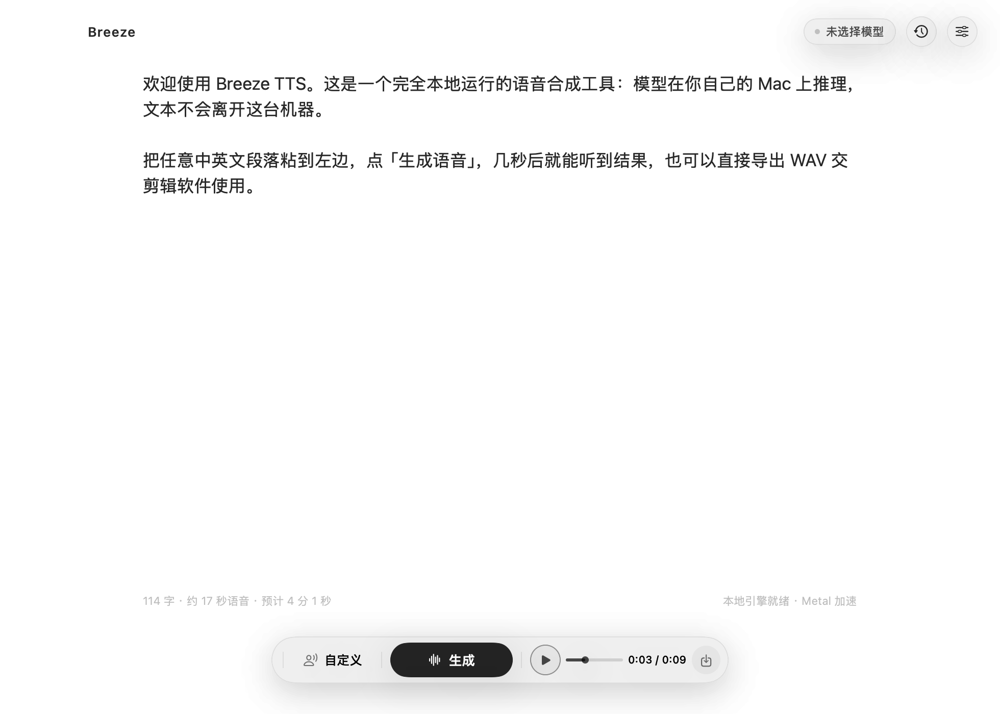

# Breeze TTS Lite for macOS

原生 macOS 语音合成应用（精简版）。SwiftUI 界面 + Objective-C++ 桥 + Breeze-TTS-2.cpp 的 C++ 引擎，
**没有 WebView、没有本地 HTTP 服务、没有浏览器**，推理全部在进程内完成，文本与音频都不上传。

精简版相对完整版去掉了「对话」「听书」以及 iPhone 遥控，只保留「输入文字 → 生成语音 → 导出 WAV」
和音色管理，体积更小、依赖更少。

- 引擎：[`HoppouAI/Breeze-TTS-2.cpp`](https://github.com/HoppouAI/Breeze-TTS-2.cpp)（Apache-2.0，Metal 后端）
- 界面：SwiftUI，液态玻璃（macOS 26+）/ 毛玻璃（低版本自动降级）
- 产物：arm64 `.app`，DMG 分发

> ⚠️ **仅供个人学习、研究与自用。** 请勿用于违法用途或侵害他人权益（尤其是未经授权克隆他人声音）。
> 本项目按「现状」提供、不附带担保，使用风险自负。详见 [DISCLAIMER.md](DISCLAIMER.md)。
> 如有侵权请通过 Issues 告知，核实后 72 小时内下架。



## 下载安装

不想自己编译，直接下 DMG：

**[⬇︎ 下载 BreezeTTS-Lite-1.0-arm64.dmg（约 4.6 MB）](https://github.com/keshaogang/BreezeTTS-Lite/releases/download/v1.0/BreezeTTS-Lite-1.0-arm64.dmg)**

1. 打开 DMG，把 `BreezeTTS Lite.app` 拖进「应用程序」。
2. 首次打开若提示「无法验证开发者」→ 右键 App → 打开；若提示「已损坏」→ 终端执行
   `xattr -cr "/Applications/BreezeTTS Lite.app"`。（未做 Apple 公证，属正常现象）
3. 首次启动引导页选一个模型档位下载（Q8_0 约 3.6 GB；8 GB 内存建议 Q4_K），下完即可全程离线。

模型权重不随仓库分发，需在应用内下载。全部数据都在 `~/Library/Application Support/BreezeTTS Lite`，
卸载时删掉该目录即可。

## 系统要求

| 项目 | 要求 |
| --- | --- |
| 芯片 | Apple Silicon（M1 / M2 / M3 / M4 / M5 及以后），**不支持 Intel** |
| 系统 | macOS 12 Monterey 及以上 |
| 内存 | 8 GB 可跑 Q4_K；16 GB 及以上推荐 Q8_0 |
| 磁盘 | 首次需下载 2.5–3.6 GB 模型，建议留 4 GB 以上 |

## 快速开始

```bash
# 1. 引擎（产出 Vendor/libbreeze.dylib；仓库已带预编译版，可跳过）
scripts/build_mac.sh arm64

# 2. 生成 Xcode 工程，再打三个补丁：bundle id / 产品名 / 纯 arm64
python3 scripts/gen_project.py
python3 scripts/patch_lite.py

# 3. 编译（Release，arm64）
xcodebuild -project BreezeTTS.xcodeproj -scheme BreezeTTS \
  -configuration Release -destination "platform=macOS,arch=arm64" \
  -derivedDataPath build/lite build
# 产物：build/lite/Build/Products/Release/BreezeTTS Lite.app

# 4. 模型（默认下到 ~/Library/Application Support/BreezeTTS Lite/models）
scripts/download_models.sh q8_0

open "build/lite/Build/Products/Release/BreezeTTS Lite.app"
```

编译需要 Xcode 15+ 与 CMake / Ninja（`scripts/build_mac.sh` 只用标准工具链）。
模型默认走 `hf-mirror.com` 镜像，可用 `HF_BASE` 环境变量切回 `huggingface.co`。

打包 DMG 用 `dmg-src/` 作源目录（App + Applications 快捷方式 + 首次打开说明.txt）：

```bash
ditto "build/lite/Build/Products/Release/BreezeTTS Lite.app" "dmg-src/BreezeTTS Lite.app"
hdiutil create -volname "BreezeTTS Lite" -srcfolder dmg-src -ov -format UDZO BreezeTTS-Lite.dmg
```

## 数据目录

模型、音色、历史、导出全部在：

```
~/Library/Application Support/BreezeTTS Lite/
├── models/        # *.gguf 权重
├── voices/        # 克隆音色的参考音频
├── recordings/    # 录音临时文件
├── exports/       # 生成的 WAV（可在设置里改）
├── voices.json    # 音色列表
└── history.json   # 生成历史
```

与电脑上其他 BreezeTTS 完全隔离。删掉这个文件夹即回到「刚安装」的空白状态。

## 选模策略

| 档位 | 文件 | 峰值内存 | 说明 |
| --- | --- | --- | --- |
| F16 | 6.3 GB | ~7 GB | 听感上限，仅建议 24 GB 以上机器 |
| Q8_0 | 3.6 GB | ~4 GB | 默认推荐，几乎听不出与 F16 的差别 |
| Q6_K | 3.0 GB | ~3.5 GB | 体积与音质折中 |
| Q4_K | 2.5 GB | ~3 GB | 内存最省，8 GB 机器推荐 |
| Q8_0-dd2 / -dd4、Q4_K-dd2 | 2.5–3.4 GB | ~2.9–4 GB | 实验档，短句更快，长文本不建议 |

引导页按本机内存推荐档位，也允许手动覆盖或导入任意 `.gguf`。

## 音色

- **文字生成**：一句话描述（性别、年龄、语速、情绪）直接生成音色
- **音频克隆**：录 5–20 秒参考音频，按参考音色复刻；可再叠一段文字补充语气
- 内置默认音色为中文成年女声，自然、无播音腔
- 已有音色与已克隆音色都支持就地编辑


## 命令行快照（开发用）

打包里的 App 自带离线渲染入口，方便验收 UI，不需要真的打开窗口：

```bash
"BreezeTTS Lite.app/Contents/MacOS/BreezeTTS Lite" --snapshot out.png voices
```

| 参数 | 说明 |
| --- | --- |
| `--snapshot <路径> <screen>` | 渲染指定界面到 PNG |
| screen | `main`、`onboarding-welcome`、`onboarding-model`、`onboarding-ready`、`voices`、`voices-edit`、`voices-empty`、`settings`、`models`、`voice-menu`、`recorder`、`running` |
| `dark-` 前缀 | 渲染深色版本，例如 `dark-main`、`dark-voices` |
| `--fresh` / `--fresh-empty` | 先清空本地数据再启动，模拟「刚下载第一次打开」；`-empty` 连内置音色也不种 |

## 许可

- 本项目（应用层代码、脚本、文档）以 **Apache License 2.0** 开源，见 `LICENSE`
- 引擎 Breeze-TTS-2.cpp 亦为 Apache-2.0，源码见 `Breeze-TTS-2.Cpp/`（含原始 LICENSE，请遵守其署名与声明要求）
- 第三方组件清单与版权声明见 `NOTICE`；模型权重不随仓库分发，需在应用内或自行下载

## 免责声明（请务必阅读）

**本项目仅供个人学习、研究与自用，按「现状」提供，不附带任何担保。**

- 请勿将本项目用于任何违法用途，或用于侵害他人权益、伪造他人声音、制造虚假信息
- 声音克隆仅限**自己的声音**或**已获明确书面授权**的声音；公开发布 AI 生成音频请依法显著标识
- 你对自己输入的文本、克隆的音色与生成的内容**承担全部责任**
- **侵权告知与下架**：若认为本项目侵犯了你的权益，请在 Issues 告知并附权属证明；经核实后 **72 小时内**删除或下架（明显违法/侵权情形 **24 小时内**先行下架）

完整条款见 [DISCLAIMER.md](DISCLAIMER.md)。不同意上述条款请勿使用。

## 已知限制

- 仅 arm64，Intel Mac 无法运行
- 分发版为 ad-hoc 签名，首次打开需右键「打开」或在「隐私与安全性」里放行
- 长文本按语义分段合成，段与段之间使用同一随机种子以保证音色一致
